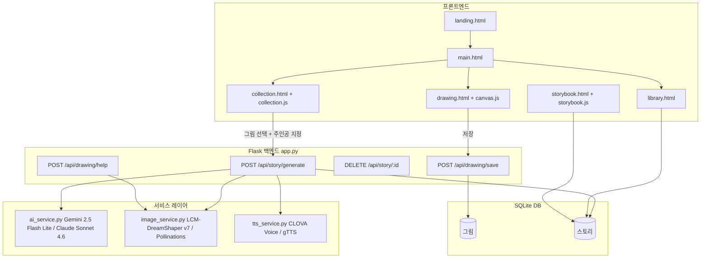
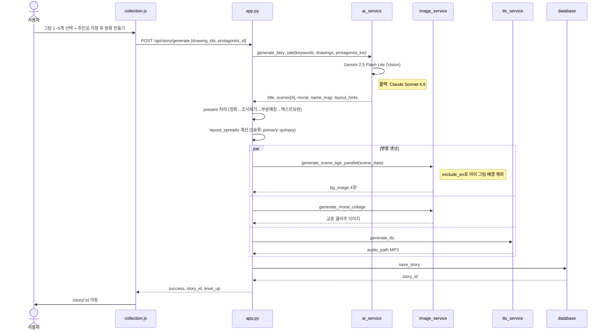
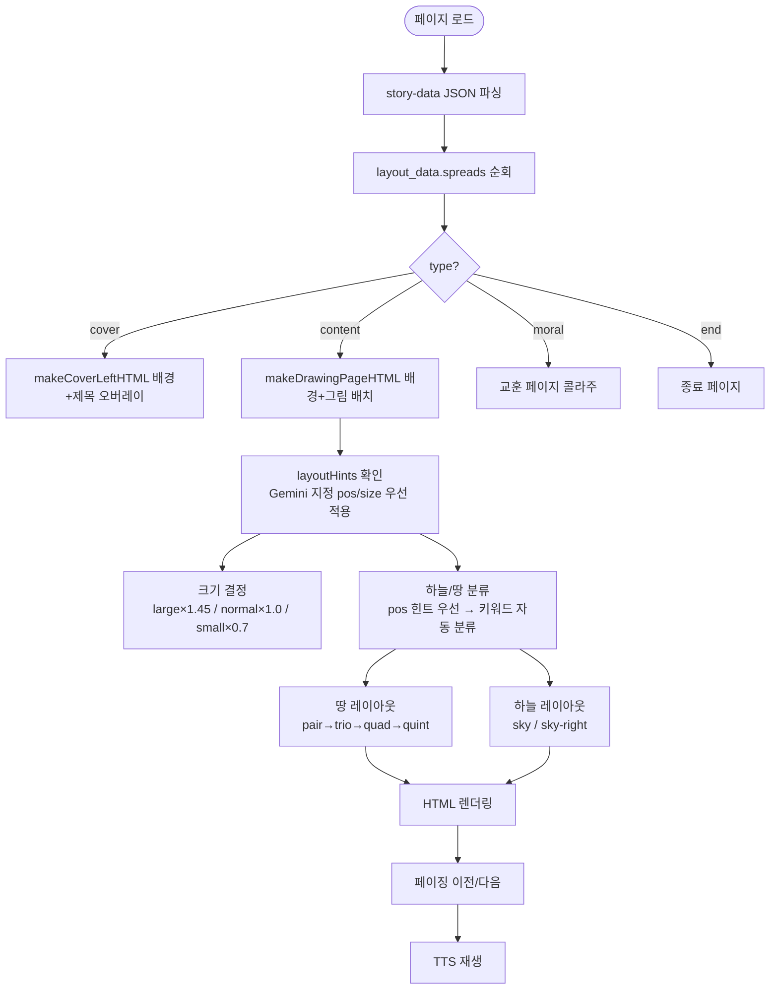

# AI 동화 만들기

아이가 직접 그린 그림으로 AI가 동화를 만들어주는 웹 앱입니다.

## 팀원 및 역할

| 이름   | 담당 역할                         |
| ------ | --------------------------------- |
| 홍찬영 | AI 스토리 생성 + 배경 이미지 생성 |
| 방혁   | 그림 그리기 캔버스 기능           |
| 김봉환 | 그린 그림 저장 및 관리            |
| 이예진 | 스토리 저장 기능                  |
| 홍수진 | 스토리 저장 기능                  |

---

## 서비스 흐름

```
① 단어를 보고 캔버스에 그림 그리기
② 그린 그림 1~5개 선택 + 주인공 지정 (선택)
③ AI가 동화 스토리 + 배경 이미지 + 음성 자동 생성
④ 완성된 동화책 감상 및 도서관에 저장
```

---

## 기술 스택

| 분류              | 기술                                                        |
| ----------------- | ----------------------------------------------------------- |
| 백엔드            | Python + Flask                                              |
| AI 동화 생성      | Gemini 2.5 Flash Lite (우선) / Claude Sonnet 4.6 (폴백)    |
| AI 배경 이미지    | LCM-DreamShaper v7 (로컬 GPU) / Pollinations.ai (폴백)     |
| AI 참고 이미지    | LCM-DreamShaper v7 (로컬 GPU, 컬러링북 스타일)             |
| TTS 음성          | CLOVA Voice - Premium (우선) / gTTS (폴백)                  |
| DB                | SQLite                                                      |
| 포트              | 5000                                                        |

---

## 환경 변수 설정

`.env` 파일을 생성하고 아래 키를 입력하세요.

| 변수                   | 필수 | 설명                              |
| ---------------------- | ---- | --------------------------------- |
| `GEMINI_API_KEY`       | 권장 | 동화 생성 (Google AI Studio)      |
| `ANTHROPIC_API_KEY`    | 선택 | Gemini 실패 시 폴백 (Claude)      |
| `CLOVA_CLIENT_ID`      | 권장 | CLOVA Voice TTS (NCP 콘솔)        |
| `CLOVA_CLIENT_SECRET`  | 권장 | CLOVA Voice TTS (NCP 콘솔)        |
| `NGROK_AUTH_TOKEN`     | 선택 | 외부 공개용 ngrok 터널            |
| `SECRET_KEY`           | 선택 | Flask 세션 키 (기본값 있음)       |

---

## 실행 방법

```bash
# 의존성 설치
pip install -r requirements.txt

# 서버 실행 (로컬)
python app.py

# 외부 공개 (ngrok)
python run_ngrok.py --token YOUR_NGROK_TOKEN

# 브라우저 접속
http://localhost:5000
```

---

## 주요 기능

### 그림 그리기

- 랜덤 단어 제시 → 캔버스에 자유롭게 그리기
- **2열 레이아웃**: 왼쪽 패널(단어 카드 / 예시 그림 / 밑그림 버튼) + 오른쪽 캔버스
- AI 참고 이미지 생성 기능 (LCM-DreamShaper v7, 컬러링북 스타일 — 4~7세 따라 그리기용)
- 그린 그림은 그림 모음장에 저장 (JS Canvas에서 흰 배경 제거 후 저장)

### AI 동화 생성

- 그림 키워드 기반으로 Gemini AI가 4장면 동화 작성
- **주인공 지정**: 선택한 그림 중 하나를 주인공으로 지정 가능 (항상 맨 앞에 배치)
- 배경 이미지 + TTS + 콜라주 **병렬 생성** (ThreadPoolExecutor 3개)
- 아이 그림 객체가 배경에 중복 등장하지 않도록 제외 처리
- CLOVA Voice로 동화 전체 음성 낭독 생성 (gTTS 폴백)
- 교훈 페이지 콜라주 이미지 자동 생성

### 동화책 뷰어

- 배경 + 아이 그림 + 텍스트 + 음성이 합쳐진 동화책 형태
- **Gemini layout_hints**: AI가 장면마다 그림의 위치(sky/ground/ground-foreground)와 크기(large/normal/small) 지정
- 그림 최대 5개 동시 배치: primary / secondary / tertiary / quaternary / quinary
- 하늘 / 땅 자동 분류 배치 (layout_hints 우선, 없으면 키워드 기반 자동 분류)
- 땅 그림 레이아웃: 1개(단독) → pair(2) → trio(3) → quad(4) → quint(5)
- 스토리 문맥에 따라 그림 크기 자동 조절

### 도서관 & 뱃지 시스템

- AI 동화 아카이빙: 생성된 나만의 동화책을 영구적으로 보관하고 언제든 다시 열람할 수 있는 도서관 페이지
- 인터랙티브 좌우 이동형 책장: 신규 생성된 책은 왼쪽 책장(<새로운 책>)에 꽂히며, 열람을 완료하면 오른쪽 책장(<읽은 책>)으로 자동 이동하여 독서 상태 직관적 분리
- 책꾸러미 (아카이브 보관함): 책장에 도서가 일정량 누적되면 측면에 '책꾸러미' 버튼이 활성화되어, 차곡차곡 쌓인 전체 누적 도서 목록을 한눈에 모아보기 가능
- 누적 독서 기반 성장형 뱃지 (Gamification): 책을 읽고 쌓아간 권수에 따라 단계별로 작가 타이틀 및 뱃지 자동 부여
- 뱃지 레벨업 로직: 🌱 새싹 작가(1~10권) → 🌳 꿈나무 작가(11~21권) → 🪄 마법 작가(22~32권) → 👑 전설 작가(33권 이상)
- 보상 연동 기능: 뱃지 등급이 업그레이드될 때마다 캔버스 도구 잠금 해제 등 앱 내 숨겨진 기능이 활성화되어 지속적인 창작 및 독서 동기 부여

---

## 전체 아키텍처



---

## 동화 생성 흐름



---

## 동화책 뷰어 렌더링 흐름



---

## 그림 배치 상세

### 슬롯 구조 (최대 5개)

| 슬롯        | 우선순위 | 비고                      |
| ----------- | -------- | ------------------------- |
| primary     | 1        | 주인공 or 첫 번째 그림    |
| secondary   | 2        |                           |
| tertiary    | 3        |                           |
| quaternary  | 4        |                           |
| quinary     | 5        |                           |

### 땅 레이아웃 CSS 클래스

| 그림 수 | CSS 클래스                                               |
| ------- | -------------------------------------------------------- |
| 1       | (기본 위치)                                              |
| 2       | `ground-pair-l` / `ground-pair-r`                        |
| 3       | `ground-trio-l` / `ground-trio-c` / `ground-trio-r`      |
| 4       | `ground-quad-1` ~ `ground-quad-4`                        |
| 5       | `ground-quint-1` ~ `ground-quint-5`                      |

### layout_hints (Gemini 지정)

| pos 값              | 배치                        |
| ------------------- | --------------------------- |
| `sky`               | 하늘 중앙                   |
| `sky-right`         | 하늘 우측                   |
| `ground`            | 땅 기본                     |
| `ground-foreground` | 땅 전면 중앙 (z-index 높음) |

| size 값  | 스케일 |
| -------- | ------ |
| `large`  | ×1.45  |
| `normal` | ×1.0   |
| `small`  | ×0.7   |

### ALWAYS_GROUND_KW (항상 땅에 배치)

나무, 꽃, 집, 산, 성, 탑, 다리, 마을, 동굴, 버섯, 풀, 바위, 강, 연못, 나뭇잎, 씨앗

---

## AI 서비스 상세 (`services/ai_service.py`)

### 모델

- **기본**: `gemini-2.5-flash-lite` (Google AI Studio, 무료)
- **폴백**: `claude-sonnet-4-6` (Anthropic)

### AI 반환 구조

```json
{
  "title": "동화 제목",
  "scenes": [
    {
      "text": "장면 텍스트",
      "background": "배경 설명 (영어)",
      "present": ["키워드1", "키워드2"],
      "layout_hints": {
        "키워드": { "pos": "ground", "size": "large" }
      }
    }
  ],
  "moral": "교훈 문장",
  "name_map": { "원래키워드": "AI가_붙인_이름" }
}
```

### present 처리 순서 (`app.py`)

1. 정확 매칭 (`kw_to_id`, `char_name_to_id`)
2. 조사 제거 후 재시도 (`"냥이가"` → `"냥이"`)
3. 부분 매칭 (`"뭉게"` → `"뭉게구름"`)
4. 텍스트 언급 보완 (AI present 누락분 자동 추가)
